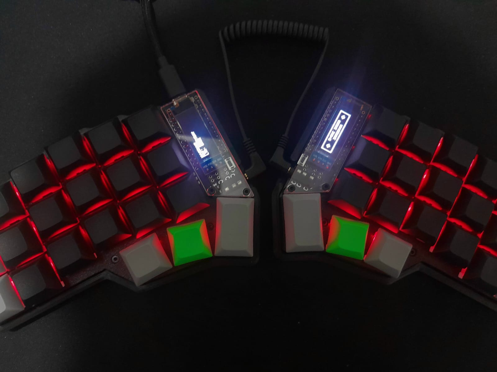

# Nyverune Corne

<p align="center">
  
</p>

Personal collection of custom keyboard layouts and configurations for the Corne (crkbd) split keyboard, designed around ergonomics, productivity, and specialized workflows.

The project maintains reproducible, documented, and version-controlled configurations using QMK firmware with a consistent Spanish QWERTY primary layer across all profiles.

## Technical Specifications

| Component           | Selection                                                   |
| ------------------- | ----------------------------------------------------------- |
| Keyboard            | Corne (crkbd) 3x6+3 (42 keys)                               |
| Microcontroller     | RP2040 / ATmega32U4 (`CONVERT_TO=rp2040_ce`)                |
| Firmware            | QMK Firmware                                                |
| Base layout         | Spanish QWERTY (native `Ñ` and punctuation)                 |
| Primary layer       | Shared across all profiles                                  |
| Secondary layers    | Profile-specific (Everyday, Neovim)                         |
| Visual Diagrams     | Vector SVG & ASCII generated with official Nyverune palette |
| OLED Display        | 128x32 SSD1306 custom pixel-art Nyverune logo & keylogger   |
| Profile Switching   | Runtime Raw HID (<1ms) & Hardware hotkey switching          |
| Target environments | Linux (Arch Linux / Hyprland) and Windows                   |

## Repository Structure

```
nyverune-corne/
├── layouts/           # Declarative JSON layout definitions per profile
│   ├── shared/        # Shared base layer definitions
│   ├── everyday/      # Everyday profile definitions
│   └── neovim/        # Neovim profile definitions
├── firmware/          # QMK source files, rules, and keymaps
│   ├── shared/        # Shared QMK headers, combos, OLED logo, and Spanish keycodes
│   └── keymaps/       # Profile-specific QMK keymaps
│       ├── everyday/  # Everyday keymap (keymap.c, rules.mk, config.h)
│       └── neovim/    # Neovim keymap (keymap.c, rules.mk, config.h)
├── diagrams/          # Generated visual layout diagrams (SVG & ASCII)
│   ├── everyday/      # Everyday profile SVG layers
│   └── neovim/        # Neovim profile SVG layers
├── docs/              # Comprehensive design, layer, and flashing documentation
└── scripts/           # Validation, diagram, desktop daemons, and widget utilities
```

## Profiles

- **Everyday:** General-purpose layout for typing, navigation, numbers, symbols, and window management.
  - [Everyday Layout Documentation](docs/everyday_layout.md)
  - [Everyday Visual Diagrams](diagrams/everyday/README.md)
- **Neovim:** Modal editing layout with dedicated layers for HJKL navigation, window splits, buffer management, and LSP controls.
  - [Neovim Layout Documentation](docs/neovim_layout.md)
  - [Neovim Visual Diagrams](diagrams/neovim/README.md)

## Development Milestones

- [x] **Milestone 1 — Project Foundation**
  - [x] Establish the repository structure.
  - [x] Configure the QMK development environment.
  - [x] Define the shared primary layer.
  - [x] Establish the Spanish QWERTY keymap.
  - [x] Define conventions for layout and layer organization.
- [x] **Milestone 2 — Initial Layouts**
  - [x] Implement the Everyday layout.
  - [x] Implement the Neovim layout.
  - [x] Design and configure specialized secondary layers.
  - [x] Test both layouts on the Corne keyboard (automated validation & checklist).
  - [x] Refine mappings based on practical usage.
- [x] **Milestone 3 — Documentation and Diagrams**
  - [x] Establish a diagram generation workflow.
  - [x] Generate visual representations of each layout.
  - [x] Implement automatic documentation generation.
  - [x] Document layers, key mappings, and design decisions.
  - [x] Document firmware compilation and flashing.
- [x] **Milestone 4 — Profile Management Exploration**
  - [x] Investigate runtime profile switching mechanisms in QMK.
  - [x] Evaluate switching profiles without reflashing firmware.
  - [x] Explore custom scripts and desktop integration for Arch Linux (Hyprland IPC / Lua).
  - [x] Investigate equivalent tooling for Windows (Win32 active window watcher).
  - [x] Evaluate the feasibility of custom desktop widgets for profile switching (Waybar & Rofi).
