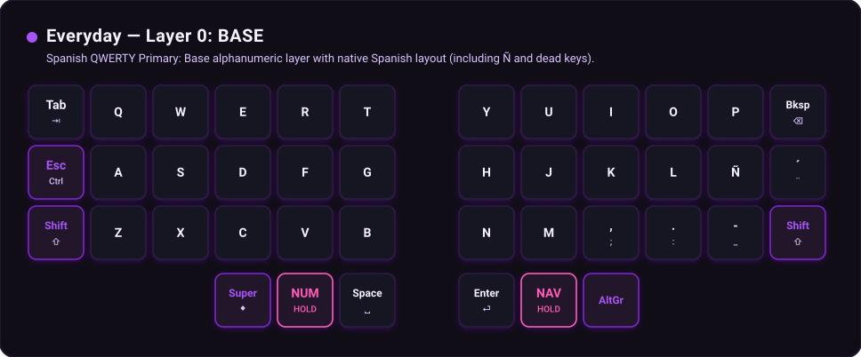
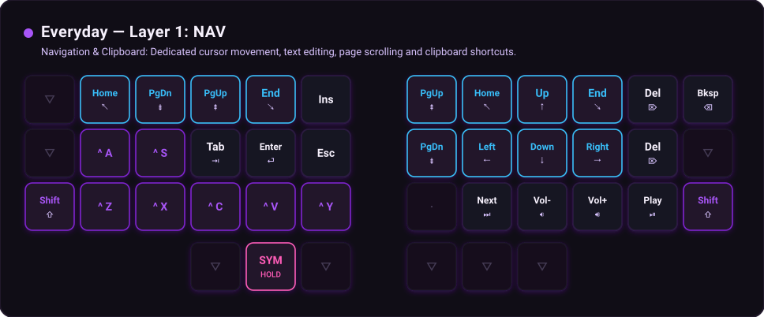
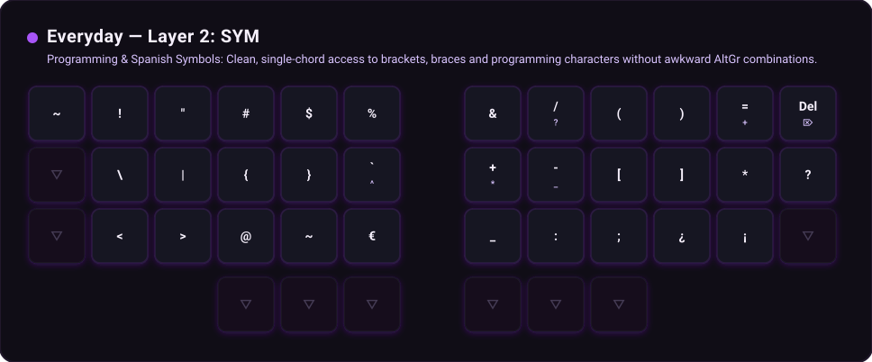
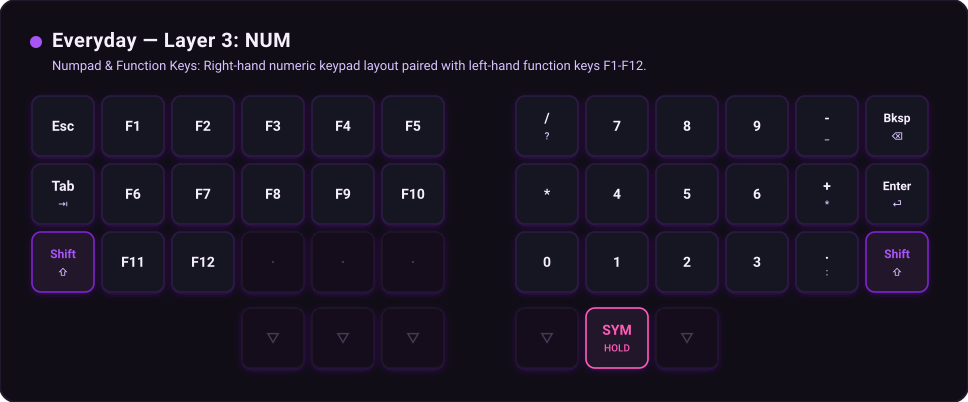
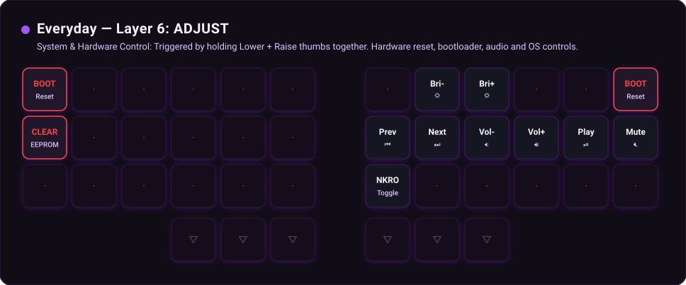

# Everyday Profile — Visual Diagrams

## Layer 0: BASE



### Layer 0: BASE (Spanish QWERTY Primary)

```
[  Tab  ] [   Q   ] [   W   ] [   E   ] [   R   ] [   T   ]    [   Y   ] [   U   ] [   I   ] [   O   ] [   P   ] [ Bksp  ]
[  Esc  ] [   A   ] [   S   ] [   D   ] [   F   ] [   G   ]    [   H   ] [   J   ] [   K   ] [   L   ] [   Ñ   ] [   ´   ]
[ Shift ] [   Z   ] [   X   ] [   C   ] [   V   ] [   B   ]    [   N   ] [   M   ] [   ,   ] [   .   ] [   -   ] [ Shift ]
                              [ Super ] [  NUM  ] [ Space ]    [  Ent  ] [  NAV  ] [ AltGr ]
```

## Layer 1: NAV



### Layer 1: NAV (Navigation & Clipboard)

```
[   ▽   ] [ Home  ] [ PgDn  ] [ PgUp  ] [  End  ] [  Ins  ]    [ PgUp  ] [ Home  ] [  Up   ] [  End  ] [  Del  ] [ Bksp  ]
[   ▽   ] [  ^ A  ] [  ^ S  ] [  Tab  ] [ Enter ] [  Esc  ]    [ PgDn  ] [ Left  ] [ Down  ] [ Right ] [  Del  ] [   ▽   ]
[ Shift ] [  ^ Z  ] [  ^ X  ] [  ^ C  ] [  ^ V  ] [  ^ Y  ]    [   ·   ] [ Next  ] [ Vol-  ] [ Vol+  ] [ Play  ] [ Shift ]
                              [   ▽   ] [  SYM  ] [   ▽   ]    [   ▽   ] [   ▽   ] [   ▽   ]
```

## Layer 2: SYM



### Layer 2: SYM (Programming & Spanish Symbols)

```
[   ~   ] [   !   ] [   "   ] [   #   ] [   $   ] [   %   ]    [   &   ] [   /   ] [   (   ] [   )   ] [   =   ] [  Del  ]
[   ▽   ] [   \   ] [   |   ] [   {   ] [   }   ] [   `   ]    [   +   ] [   -   ] [   [   ] [   ]   ] [   *   ] [   ?   ]
[   ▽   ] [   <   ] [   >   ] [   @   ] [   ~   ] [   €   ]    [   _   ] [   :   ] [   ;   ] [   ¿   ] [   ¡   ] [   ▽   ]
                              [   ▽   ] [   ▽   ] [   ▽   ]    [   ▽   ] [   ▽   ] [   ▽   ]
```

## Layer 3: NUM



### Layer 3: NUM (Numpad & Function Keys)

```
[  Esc  ] [  F1   ] [  F2   ] [  F3   ] [  F4   ] [  F5   ]    [   /   ] [   7   ] [   8   ] [   9   ] [   -   ] [ Bksp  ]
[  Tab  ] [  F6   ] [  F7   ] [  F8   ] [  F9   ] [  F10  ]    [   *   ] [   4   ] [   5   ] [   6   ] [   +   ] [ Enter ]
[ Shift ] [  F11  ] [  F12  ] [   ·   ] [   ·   ] [   ·   ]    [   0   ] [   1   ] [   2   ] [   3   ] [   .   ] [ Shift ]
                              [   ▽   ] [   ▽   ] [   ▽   ]    [   ▽   ] [  SYM  ] [   ▽   ]
```

## Layer 6: ADJUST



### Layer 6: ADJUST (System & Hardware Control)

```
[ BOOT  ] [   ·   ] [   ·   ] [   ·   ] [   ·   ] [   ·   ]    [   ·   ] [ Bri-  ] [ Bri+  ] [   ·   ] [   ·   ] [ BOOT  ]
[ CLEAR ] [   ·   ] [   ·   ] [   ·   ] [   ·   ] [   ·   ]    [ Prev  ] [ Next  ] [ Vol-  ] [ Vol+  ] [ Play  ] [ Mute  ]
[   ·   ] [   ·   ] [   ·   ] [   ·   ] [   ·   ] [   ·   ]    [ NKRO  ] [   ·   ] [   ·   ] [   ·   ] [   ·   ] [   ·   ]
                              [   ▽   ] [   ▽   ] [   ▽   ]    [   ▽   ] [   ▽   ] [   ▽   ]
```
