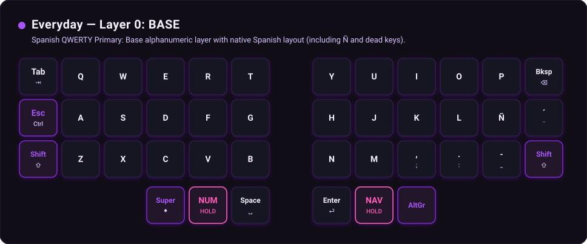
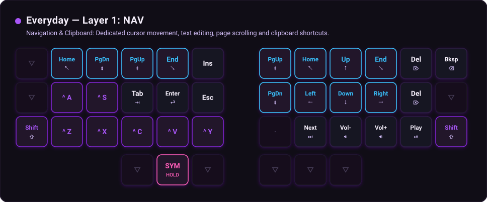
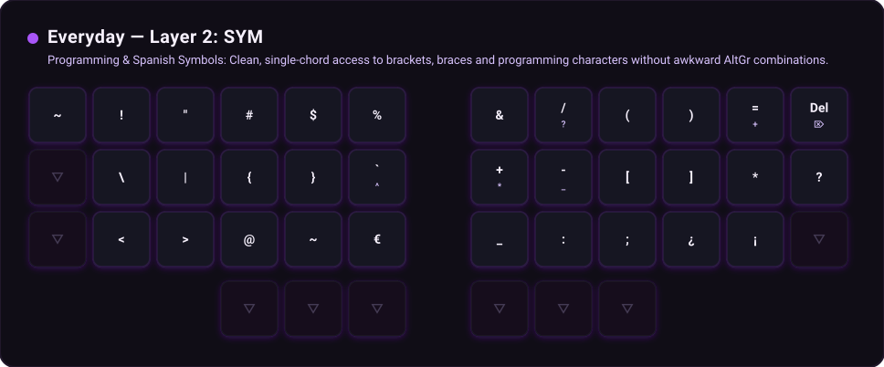
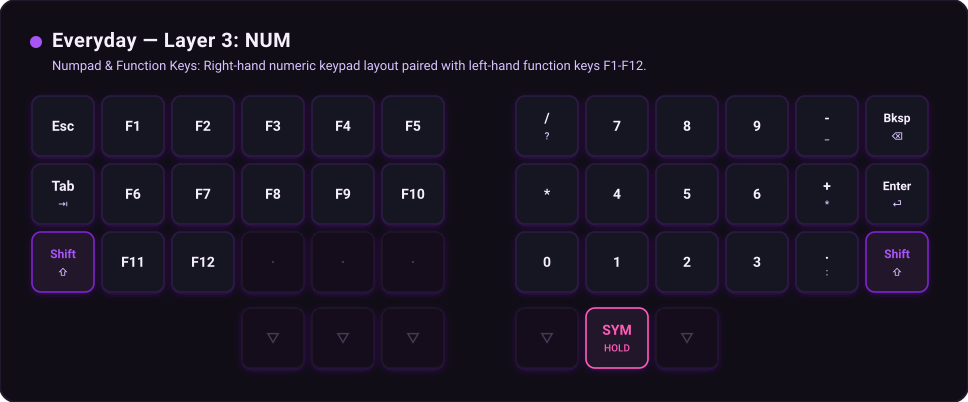
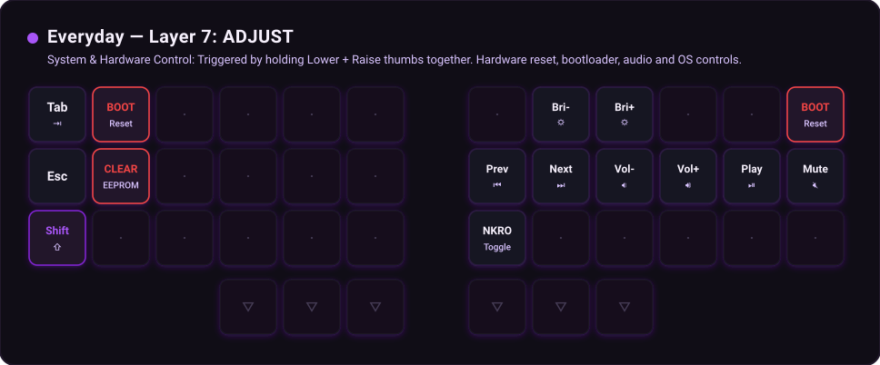

# Everyday Profile — Layout & Keymap Documentation

> General-purpose layout for daily typing, document writing, standard coding and navigation on Spanish QWERTY.

## Architecture Overview

- **Base Typology:** Spanish QWERTY (native `Ñ`, accents and dead keys).
- **Physical Matrix:** Corne split (3x6+3, 42 keys total).
- **Active Layers in this Profile:** 5 layers.

---

## Layer 0: BASE — Spanish QWERTY Primary

*Base alphanumeric layer with native Spanish layout (including Ñ and dead keys).*

### Key Mapping Matrix

| Position | Hand | Row | QMK Keycode | Primary Function |
|---|---|---|---|---|
| L00 | Left | Top Row | `KC_TAB` | Tab (⇥) |
| L01 | Left | Top Row | `ES_Q` | Q |
| L02 | Left | Top Row | `ES_W` | W |
| L03 | Left | Top Row | `ES_E` | E |
| L04 | Left | Top Row | `ES_R` | R |
| L05 | Left | Top Row | `ES_T` | T |
| R00 | Right | Top Row | `ES_Y` | Y |
| R01 | Right | Top Row | `ES_U` | U |
| R02 | Right | Top Row | `ES_I` | I |
| R03 | Right | Top Row | `ES_O` | O |
| R04 | Right | Top Row | `ES_P` | P |
| R05 | Right | Top Row | `KC_BSPC` | Backspace (⌫) |
| L10 | Left | Home Row | `LCTL_T(KC_ESC)` | Tap: ESC | Hold: Left Ctrl |
| L11 | Left | Home Row | `ES_A` | A |
| L12 | Left | Home Row | `ES_S` | S |
| L13 | Left | Home Row | `ES_D` | D |
| L14 | Left | Home Row | `ES_F` | F |
| L15 | Left | Home Row | `ES_G` | G |
| R10 | Right | Home Row | `ES_H` | H |
| R11 | Right | Home Row | `ES_J` | J |
| R12 | Right | Home Row | `ES_K` | K |
| R13 | Right | Home Row | `ES_L` | L |
| R14 | Right | Home Row | `ES_NTIL` | Ñ (Spanish) |
| R15 | Right | Home Row | `ES_ACUT` | ´ ¨ (Acute / Diaeresis) |
| L20 | Left | Bottom Row | `KC_LSFT` | Left Shift |
| L21 | Left | Bottom Row | `ES_Z` | Z |
| L22 | Left | Bottom Row | `ES_X` | X |
| L23 | Left | Bottom Row | `ES_C` | C |
| L24 | Left | Bottom Row | `ES_V` | V |
| L25 | Left | Bottom Row | `ES_B` | B |
| R20 | Right | Bottom Row | `ES_N` | N |
| R21 | Right | Bottom Row | `ES_M` | M |
| R22 | Right | Bottom Row | `ES_COMM` | , (Comma) |
| R23 | Right | Bottom Row | `ES_DOT` | . (Period) |
| R24 | Right | Bottom Row | `ES_MINS` | - (Hyphen) |
| R25 | Right | Bottom Row | `KC_RSFT` | Right Shift |
| LT0 | Left | Thumb (Outer Thumb) | `KC_LGUI` | Super / Windows (◆) |
| LT1 | Left | Thumb (Center Thumb) | `MO(3)` | Momentary Layer Num |
| LT2 | Left | Thumb (Inner Thumb) | `KC_SPC` | Space (␣) |
| RT0 | Right | Thumb (Inner Thumb) | `RCTL_T(KC_ENT)` | RCTL_T(ENT) |
| RT1 | Right | Thumb (Center Thumb) | `MO(1)` | Momentary Layer Nav |
| RT2 | Right | Thumb (Outer Thumb) | `LT(2,KC_RALT)` | LT(2,RALT) |

---

## Layer 1: NAV — Navigation & Clipboard

*Dedicated cursor movement, text editing, page scrolling and clipboard shortcuts.*

### Key Mapping Matrix

| Position | Hand | Row | QMK Keycode | Primary Function |
|---|---|---|---|---|
| L00 | Left | Top Row | `KC_TAB` | Tab (⇥) |
| L01 | Left | Top Row | `KC_HOME` | HOME |
| L02 | Left | Top Row | `KC_PGDN` | PGDN |
| L03 | Left | Top Row | `KC_PGUP` | PGUP |
| L04 | Left | Top Row | `KC_END` | END |
| L05 | Left | Top Row | `KC_INS` | INS |
| R00 | Right | Top Row | `KC_PGUP` | PGUP |
| R01 | Right | Top Row | `KC_HOME` | HOME |
| R02 | Right | Top Row | `KC_UP` | UP |
| R03 | Right | Top Row | `KC_END` | END |
| R04 | Right | Top Row | `KC_DEL` | Delete (Del) |
| R05 | Right | Top Row | `KC_BSPC` | Backspace (⌫) |
| L10 | Left | Home Row | `KC_ESC` | Escape (Esc) |
| L11 | Left | Home Row | `LCTL(KC_A)` | Ctrl + A |
| L12 | Left | Home Row | `LCTL(KC_S)` | Ctrl + S |
| L13 | Left | Home Row | `LCTL(KC_F)` | Ctrl + F |
| L14 | Left | Home Row | `KC_ENT` | Enter (⏎) |
| L15 | Left | Home Row | `LCTL(KC_W)` | Ctrl + W |
| R10 | Right | Home Row | `KC_PGDN` | PGDN |
| R11 | Right | Home Row | `KC_LEFT` | LEFT |
| R12 | Right | Home Row | `KC_DOWN` | DOWN |
| R13 | Right | Home Row | `KC_RGHT` | RGHT |
| R14 | Right | Home Row | `KC_DEL` | Delete (Del) |
| R15 | Right | Home Row | `KC_TRNS` | ▽ (Transparent) |
| L20 | Left | Bottom Row | `KC_LSFT` | Left Shift |
| L21 | Left | Bottom Row | `LCTL(KC_Z)` | Ctrl + Z |
| L22 | Left | Bottom Row | `LCTL(KC_X)` | Ctrl + X |
| L23 | Left | Bottom Row | `LCTL(KC_C)` | Ctrl + C |
| L24 | Left | Bottom Row | `LCTL(KC_V)` | Ctrl + V |
| L25 | Left | Bottom Row | `LCTL(KC_Y)` | Ctrl + Y |
| R20 | Right | Bottom Row | `KC_NO` | · (No Key) |
| R21 | Right | Bottom Row | `KC_MNXT` | Next Track |
| R22 | Right | Bottom Row | `KC_VOLD` | Volume Down |
| R23 | Right | Bottom Row | `KC_VOLU` | Volume Up |
| R24 | Right | Bottom Row | `KC_MPLY` | Play / Pause |
| R25 | Right | Bottom Row | `KC_RSFT` | Right Shift |
| LT0 | Left | Thumb (Outer Thumb) | `MO(2)` | Momentary Layer Sym |
| LT1 | Left | Thumb (Center Thumb) | `KC_TRNS` | ▽ (Transparent) |
| LT2 | Left | Thumb (Inner Thumb) | `KC_TRNS` | ▽ (Transparent) |
| RT0 | Right | Thumb (Inner Thumb) | `KC_TRNS` | ▽ (Transparent) |
| RT1 | Right | Thumb (Center Thumb) | `KC_TRNS` | ▽ (Transparent) |
| RT2 | Right | Thumb (Outer Thumb) | `MO(2)` | Momentary Layer Sym |

---

## Layer 2: SYM — Programming & Spanish Symbols

*Clean, single-chord access to brackets, braces and programming characters without awkward AltGr combinations.*

### Key Mapping Matrix

| Position | Hand | Row | QMK Keycode | Primary Function |
|---|---|---|---|---|
| L00 | Left | Top Row | `KC_TAB` | Tab (⇥) |
| L01 | Left | Top Row | `ES_EXLM` | EXLM |
| L02 | Left | Top Row | `ES_DQUO` | DQUO |
| L03 | Left | Top Row | `ES_HASH` | # (Hash) |
| L04 | Left | Top Row | `ES_DLR` | DLR |
| L05 | Left | Top Row | `ES_PERC` | % (Percent) |
| R00 | Right | Top Row | `ES_AMPR` | & (Ampersand) |
| R01 | Right | Top Row | `ES_SLSH` | / (Slash) |
| R02 | Right | Top Row | `ES_LPRN` | ( (Left Paren) |
| R03 | Right | Top Row | `ES_RPRN` | ) (Right Paren) |
| R04 | Right | Top Row | `ES_EQL` | EQL |
| R05 | Right | Top Row | `KC_DEL` | Delete (Del) |
| L10 | Left | Home Row | `KC_ESC` | Escape (Esc) |
| L11 | Left | Home Row | `ES_BSLS` | \ (Backslash) |
| L12 | Left | Home Row | `ES_PIPE` | | (Pipe) |
| L13 | Left | Home Row | `ES_LCBR` | { (Left Brace) |
| L14 | Left | Home Row | `ES_RCBR` | } (Right Brace) |
| L15 | Left | Home Row | `ES_GRV` | GRV |
| R10 | Right | Home Row | `ES_PLUS` | + (Plus) |
| R11 | Right | Home Row | `ES_MINS` | - (Hyphen) |
| R12 | Right | Home Row | `ES_LBRC` | [ (Left Bracket) |
| R13 | Right | Home Row | `ES_RBRC` | ] (Right Bracket) |
| R14 | Right | Home Row | `ES_ASTR` | * (Asterisk) |
| R15 | Right | Home Row | `ES_QUES` | ? (Question) |
| L20 | Left | Bottom Row | `KC_LSFT` | Left Shift |
| L21 | Left | Bottom Row | `ES_LABK` | < (Less than) |
| L22 | Left | Bottom Row | `ES_RABK` | > (Greater than) |
| L23 | Left | Bottom Row | `ES_ATSN` | @ (At) |
| L24 | Left | Bottom Row | `ES_TILD` | ~ (Tilde) |
| L25 | Left | Bottom Row | `ES_EURO` | € (Euro) |
| R20 | Right | Bottom Row | `ES_UNDS` | _ (Underscore) |
| R21 | Right | Bottom Row | `ES_COLN` | : (Colon) |
| R22 | Right | Bottom Row | `ES_SCLN` | ; (Semicolon) |
| R23 | Right | Bottom Row | `ES_IQUE` | ¿ (Inverted Question) |
| R24 | Right | Bottom Row | `ES_IEXC` | ¡ (Inverted Exclamation) |
| R25 | Right | Bottom Row | `KC_RSFT` | Right Shift |
| LT0 | Left | Thumb (Outer Thumb) | `KC_TRNS` | ▽ (Transparent) |
| LT1 | Left | Thumb (Center Thumb) | `KC_TRNS` | ▽ (Transparent) |
| LT2 | Left | Thumb (Inner Thumb) | `KC_TRNS` | ▽ (Transparent) |
| RT0 | Right | Thumb (Inner Thumb) | `KC_TRNS` | ▽ (Transparent) |
| RT1 | Right | Thumb (Center Thumb) | `KC_TRNS` | ▽ (Transparent) |
| RT2 | Right | Thumb (Outer Thumb) | `KC_TRNS` | ▽ (Transparent) |

---

## Layer 3: NUM — Numpad & Function Keys

*Right-hand numeric keypad layout paired with left-hand function keys F1-F12.*

### Key Mapping Matrix

| Position | Hand | Row | QMK Keycode | Primary Function |
|---|---|---|---|---|
| L00 | Left | Top Row | `KC_TAB` | Tab (⇥) |
| L01 | Left | Top Row | `KC_F1` | F1 |
| L02 | Left | Top Row | `KC_F2` | F2 |
| L03 | Left | Top Row | `KC_F3` | F3 |
| L04 | Left | Top Row | `KC_F4` | F4 |
| L05 | Left | Top Row | `KC_F5` | F5 |
| R00 | Right | Top Row | `ES_SLSH` | / (Slash) |
| R01 | Right | Top Row | `ES_7` | 7 |
| R02 | Right | Top Row | `ES_8` | 8 |
| R03 | Right | Top Row | `ES_9` | 9 |
| R04 | Right | Top Row | `ES_MINS` | - (Hyphen) |
| R05 | Right | Top Row | `KC_BSPC` | Backspace (⌫) |
| L10 | Left | Home Row | `KC_ESC` | Escape (Esc) |
| L11 | Left | Home Row | `KC_F6` | F6 |
| L12 | Left | Home Row | `KC_F7` | F7 |
| L13 | Left | Home Row | `KC_F8` | F8 |
| L14 | Left | Home Row | `KC_F9` | F9 |
| L15 | Left | Home Row | `KC_F10` | F10 |
| R10 | Right | Home Row | `ES_ASTR` | * (Asterisk) |
| R11 | Right | Home Row | `ES_4` | 4 |
| R12 | Right | Home Row | `ES_5` | 5 |
| R13 | Right | Home Row | `ES_6` | 6 |
| R14 | Right | Home Row | `ES_PLUS` | + (Plus) |
| R15 | Right | Home Row | `KC_ENT` | Enter (⏎) |
| L20 | Left | Bottom Row | `KC_LSFT` | Left Shift |
| L21 | Left | Bottom Row | `KC_F11` | F11 |
| L22 | Left | Bottom Row | `KC_F12` | F12 |
| L23 | Left | Bottom Row | `KC_NO` | · (No Key) |
| L24 | Left | Bottom Row | `KC_NO` | · (No Key) |
| L25 | Left | Bottom Row | `KC_NO` | · (No Key) |
| R20 | Right | Bottom Row | `ES_0` | 0 |
| R21 | Right | Bottom Row | `ES_1` | 1 |
| R22 | Right | Bottom Row | `ES_2` | 2 |
| R23 | Right | Bottom Row | `ES_3` | 3 |
| R24 | Right | Bottom Row | `ES_DOT` | . (Period) |
| R25 | Right | Bottom Row | `KC_RSFT` | Right Shift |
| LT0 | Left | Thumb (Outer Thumb) | `KC_TRNS` | ▽ (Transparent) |
| LT1 | Left | Thumb (Center Thumb) | `KC_TRNS` | ▽ (Transparent) |
| LT2 | Left | Thumb (Inner Thumb) | `KC_TRNS` | ▽ (Transparent) |
| RT0 | Right | Thumb (Inner Thumb) | `KC_TRNS` | ▽ (Transparent) |
| RT1 | Right | Thumb (Center Thumb) | `KC_TRNS` | ▽ (Transparent) |
| RT2 | Right | Thumb (Outer Thumb) | `MO(2)` | Momentary Layer Sym |

---

## Layer 7: ADJUST — System & Hardware Control

*Triggered by holding Lower + Raise thumbs together. Hardware reset, bootloader, audio and OS controls.*

### Key Mapping Matrix

| Position | Hand | Row | QMK Keycode | Primary Function |
|---|---|---|---|---|
| L00 | Left | Top Row | `KC_TAB` | Tab (⇥) |
| L01 | Left | Top Row | `QK_BOOT` | Bootloader Jump |
| L02 | Left | Top Row | `KC_NO` | · (No Key) |
| L03 | Left | Top Row | `KC_NO` | · (No Key) |
| L04 | Left | Top Row | `KC_NO` | · (No Key) |
| L05 | Left | Top Row | `KC_NO` | · (No Key) |
| R00 | Right | Top Row | `KC_NO` | · (No Key) |
| R01 | Right | Top Row | `KC_BRID` | Brightness Down |
| R02 | Right | Top Row | `KC_BRIU` | Brightness Up |
| R03 | Right | Top Row | `KC_NO` | · (No Key) |
| R04 | Right | Top Row | `KC_NO` | · (No Key) |
| R05 | Right | Top Row | `QK_BOOT` | Bootloader Jump |
| L10 | Left | Home Row | `KC_ESC` | Escape (Esc) |
| L11 | Left | Home Row | `EE_CLR` | Clear EEPROM |
| L12 | Left | Home Row | `KC_NO` | · (No Key) |
| L13 | Left | Home Row | `KC_NO` | · (No Key) |
| L14 | Left | Home Row | `KC_NO` | · (No Key) |
| L15 | Left | Home Row | `KC_NO` | · (No Key) |
| R10 | Right | Home Row | `KC_MPRV` | Previous Track |
| R11 | Right | Home Row | `KC_MNXT` | Next Track |
| R12 | Right | Home Row | `KC_VOLD` | Volume Down |
| R13 | Right | Home Row | `KC_VOLU` | Volume Up |
| R14 | Right | Home Row | `KC_MPLY` | Play / Pause |
| R15 | Right | Home Row | `KC_MUTE` | Mute Audio |
| L20 | Left | Bottom Row | `KC_LSFT` | Left Shift |
| L21 | Left | Bottom Row | `KC_NO` | · (No Key) |
| L22 | Left | Bottom Row | `KC_NO` | · (No Key) |
| L23 | Left | Bottom Row | `KC_NO` | · (No Key) |
| L24 | Left | Bottom Row | `KC_NO` | · (No Key) |
| L25 | Left | Bottom Row | `KC_NO` | · (No Key) |
| R20 | Right | Bottom Row | `NK_TOGG` | Toggle NKRO |
| R21 | Right | Bottom Row | `KC_NO` | · (No Key) |
| R22 | Right | Bottom Row | `KC_NO` | · (No Key) |
| R23 | Right | Bottom Row | `KC_NO` | · (No Key) |
| R24 | Right | Bottom Row | `KC_NO` | · (No Key) |
| R25 | Right | Bottom Row | `KC_NO` | · (No Key) |
| LT0 | Left | Thumb (Outer Thumb) | `KC_TRNS` | ▽ (Transparent) |
| LT1 | Left | Thumb (Center Thumb) | `KC_TRNS` | ▽ (Transparent) |
| LT2 | Left | Thumb (Inner Thumb) | `KC_TRNS` | ▽ (Transparent) |
| RT0 | Right | Thumb (Inner Thumb) | `KC_TRNS` | ▽ (Transparent) |
| RT1 | Right | Thumb (Center Thumb) | `KC_TRNS` | ▽ (Transparent) |
| RT2 | Right | Thumb (Outer Thumb) | `KC_TRNS` | ▽ (Transparent) |

---
